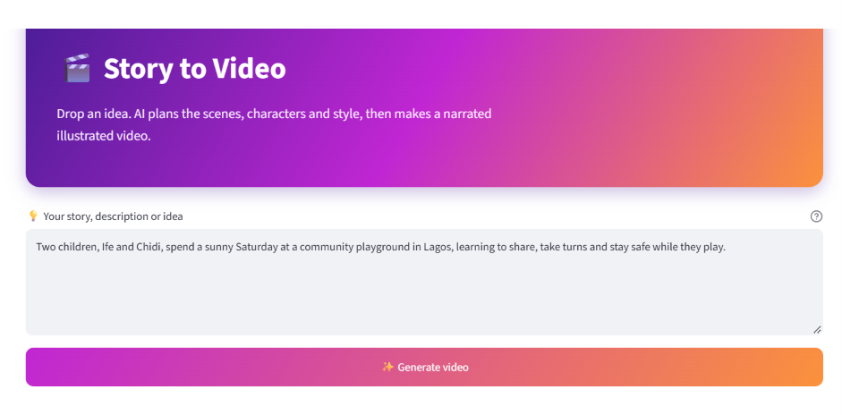
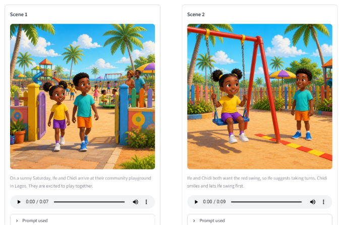
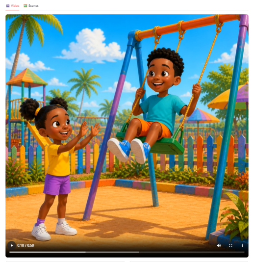

# Story to Video

Type in a short story or idea and get back a narrated, illustrated video. An OpenAI model first breaks the idea into a storyboard, then the app generates an image and a voice-over for each scene and stitches everything together with FFmpeg.

I built it to make short educational clips for kids, with Nigerian settings, names and narration, but it works for any simple story.



## What it does

1. **Plans the story.** Your idea is turned into a storyboard of up to 8 scenes, each with narration text, the characters involved and a shared visual style.
2. **Draws each scene.** Every scene gets its own image. Character descriptions are reused across scenes so the same kids look like the same kids from start to finish.
3. **Records the narration.** Each scene's text is converted to speech in a Nigerian English voice.
4. **Builds the video.** FFmpeg joins the images and audio into a single video, with each image held for as long as its narration lasts.

## Example

The prompt in the screenshot above:

> Two children, Ife and Chidi, spend a sunny Saturday at a community playground in Lagos, learning to share, take turns and stay safe while they play.

The app plans the scenes and shows each one with its image, narration audio and the prompt that produced it:



Once everything is ready, the finished video appears in the **Video** tab (this one runs just under a minute):



## Getting started

### Requirements

- Python 3.10 or newer
- [FFmpeg](https://ffmpeg.org/download.html), with `ffmpeg` and `ffprobe` both available on your PATH
- An OpenAI API key

### Install

```bash
git clone https://github.com/Jaycobson/script2visuals.git
cd script2visuals

python -m venv .venv
.venv\Scripts\activate          # macOS/Linux: source .venv/bin/activate
pip install -r requirements.txt
```

### Configure

Copy the example environment file and add your key:

```bash
copy .env.example .env          # macOS/Linux: cp .env.example .env
```

Then open `.env` and set:

```
OPENAI_API_KEY=your-key-here
```

### Run

```bash
streamlit run app.py
```

Streamlit will print a local address (usually `http://localhost:8501`). Open it, type your idea into the box and press **Generate video**.

## Project layout

```
.
├── app.py                  # Streamlit interface
├── pipeline/
│   ├── planner.py          # turns an idea into a storyboard
│   ├── script_parser.py    # reads the planner output into scenes
│   ├── backends.py         # image generation backends
│   ├── narration.py        # text-to-speech for each scene
│   ├── video.py            # FFmpeg assembly
│   └── runner.py           # runs the steps in order
├── workflows/
│   └── txt2img_api.json    # image workflow definition
├── tests/
│   ├── test_parser.py
│   └── test_planner.py
├── docs/screenshots/       # images used in this README
└── requirements.txt
```

## Tests

```bash
pytest
```

## Tips

- Short, concrete ideas work best. Naming the characters and the place gives the planner more to hold on to.
- Generation makes several API calls per scene, so a full 8-scene video takes a few minutes and costs a small amount of API credit.
- If the video step fails straight away, check that `ffmpeg -version` and `ffprobe -version` both work in your terminal.


